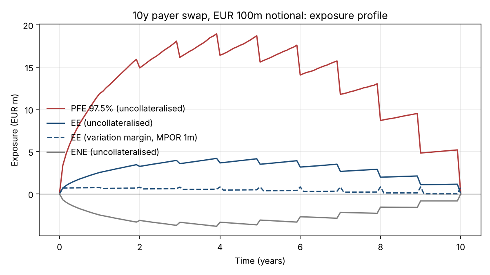

# XVA Pricing: CVA of an interest rate swap

Monte Carlo CVA / DVA of an interest rate swap under a one-factor Hull-White model,
with exposure profiles (EE, ENE, PFE, EPE), a simple variation-margin model and
credit-spread sensitivity (CS01).

The goal is a small, readable and tested implementation of the full chain:
**rate simulation → swap revaluation → exposure → CVA**.



## Method

1. **Rates.** Hull-White 1F, `dr = (θ(t) − a r) dt + σ dW`, fitted to a flat initial curve.
   The short rate is simulated exactly (`r = x + α`, with `x` an Ornstein-Uhlenbeck process),
   with antithetic variates.
2. **Revaluation.** Zero-coupon prices `P(t, T)` are analytic in Hull-White, so the swap is
   marked to market on every path and date without nested simulation.
3. **Exposure.** `EE(t) = E[max(V(t), 0)]`, `ENE(t) = E[max(−V(t), 0)]`,
   `PFE(t)` = 97.5% quantile, `EPE` = time average of EE.
4. **Collateral.** Variation margin based on the mark-to-market observed one margin period
   of risk earlier, above a threshold `H`.
5. **CVA.** Flat hazard rate from the CDS spread, `λ = s / (1 − R)`, then

   `CVA = (1 − R) · Σ E[D(0, tᵢ) · max(V(tᵢ), 0)] · (S(tᵢ₋₁) − S(tᵢ))`

   DVA is the same formula on the negative exposure with our own spread.

## Results

10-year payer swap at par (3.05%), EUR 100m notional, `a = 5%`, `σ = 1%`, flat curve at 3%,
counterparty spread 150 bp, own spread 80 bp, recovery 40%, 100,000 paths, monthly steps.

| Case | EPE | Peak PFE | CVA | DVA | CS01 |
|---|---:|---:|---:|---:|---:|
| Uncollateralised | 2,893,674 | 18,948,583 | 320,787 | 179,773 | 1,908 |
| Variation margin (MPOR 1 month) | 433,155 | 4,431,788 | 54,103 | 29,374 | 330 |

Amounts in EUR. The uncollateralised CVA is about 32 bp of notional; daily-style margining
with a one-month margin period of risk cuts it by roughly 83%. The sawtooth shape comes from
the annual coupon payments.

## Run

```bash
pip install -r requirements.txt
python -m pytest -q            # 7 tests
PYTHONPATH=. python examples/run_cva.py
```

## Tests

- simulated discount factors reprice the initial curve;
- discounted bond prices are martingales;
- a par swap is worth zero at inception and exposure vanishes at maturity;
- payer and receiver swaps are mirror images;
- CVA is zero without credit risk and increases with the spread;
- collateral reduces CVA, and perfect collateral removes it.

## Limits

- Single curve: no OIS / projection split, flat initial curve.
- Flat hazard rate, no CDS term structure bootstrap.
- Exposure and default are independent: no wrong-way risk.
- One trade, no netting set aggregation; no initial margin, FVA or KVA.
- Model parameters are illustrative, not calibrated to swaptions.

## Possible extensions

Calibration of `(a, σ)` to a swaption grid, CDS curve bootstrap, wrong-way risk through
correlated default intensity, netting across several trades, FVA.

## Author

Skander Zarrouk
